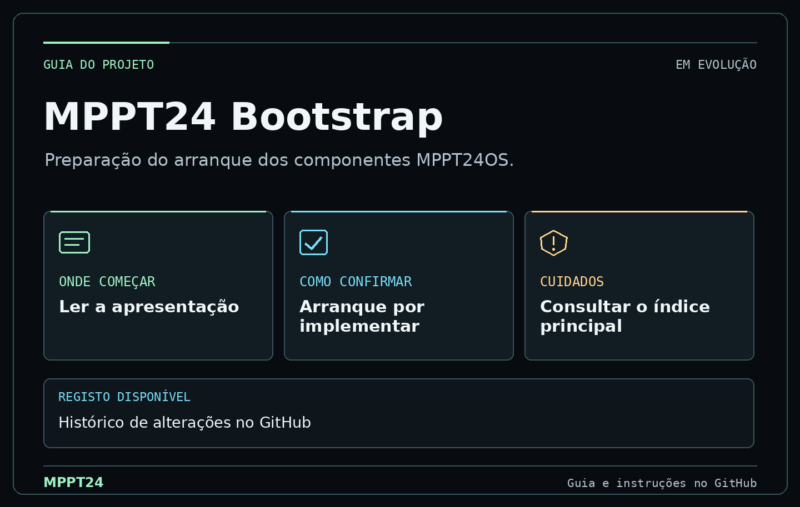

# Guia de MPPT24 Bootstrap

**Estado:** Em evolução.

Preparação do arranque dos componentes MPPT24OS.

## Onde começar

Lê a [apresentação](README.md) para saber o âmbito previsto.

## Como confirmar

A versão atual é documental. Para código já publicado, consulta o [MPPT24OS](https://github.com/mppt24/MPPT24OS#explorar-os-projetos).

## Como ler os registos

Ainda não existem registos de instalação ou testes do Bootstrap nesta edição.

Para localizar uma alteração, usa a data e a mensagem do commit no histórico Git.

## Cuidados

Mantém a distinção entre proposta de automatização e um instalador testado.
